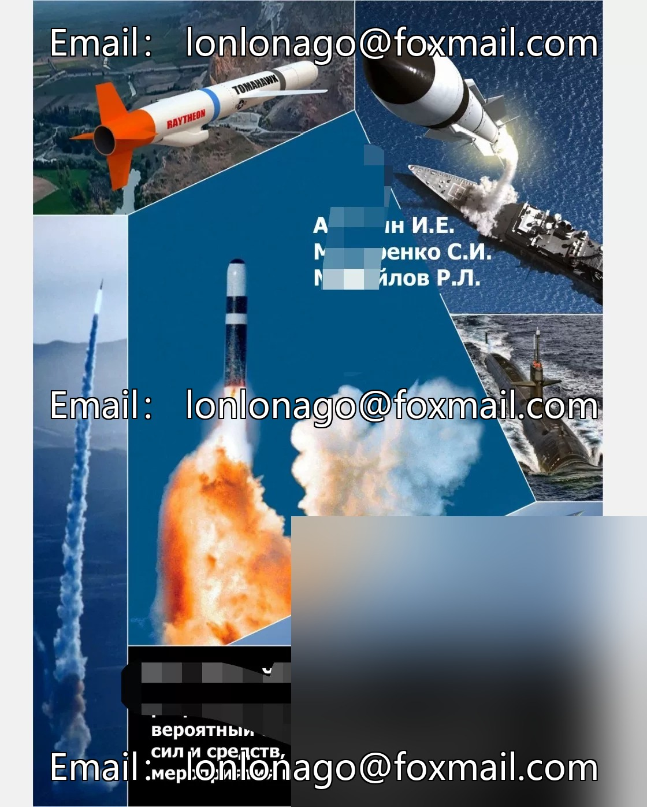
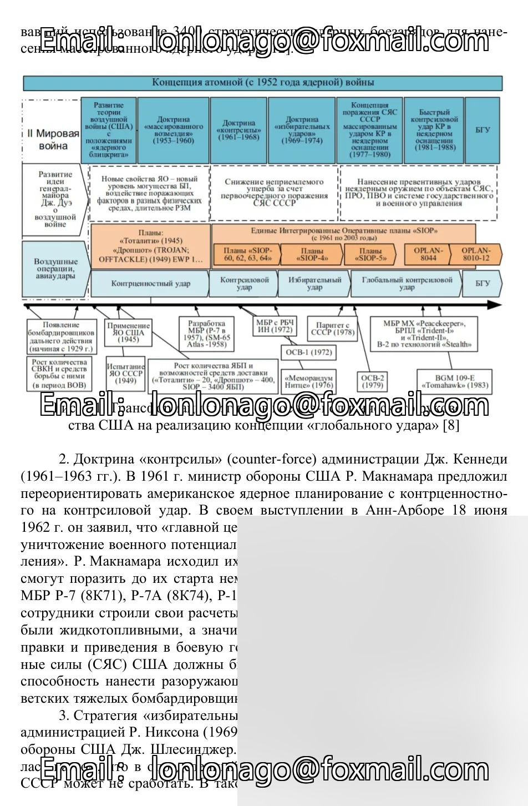
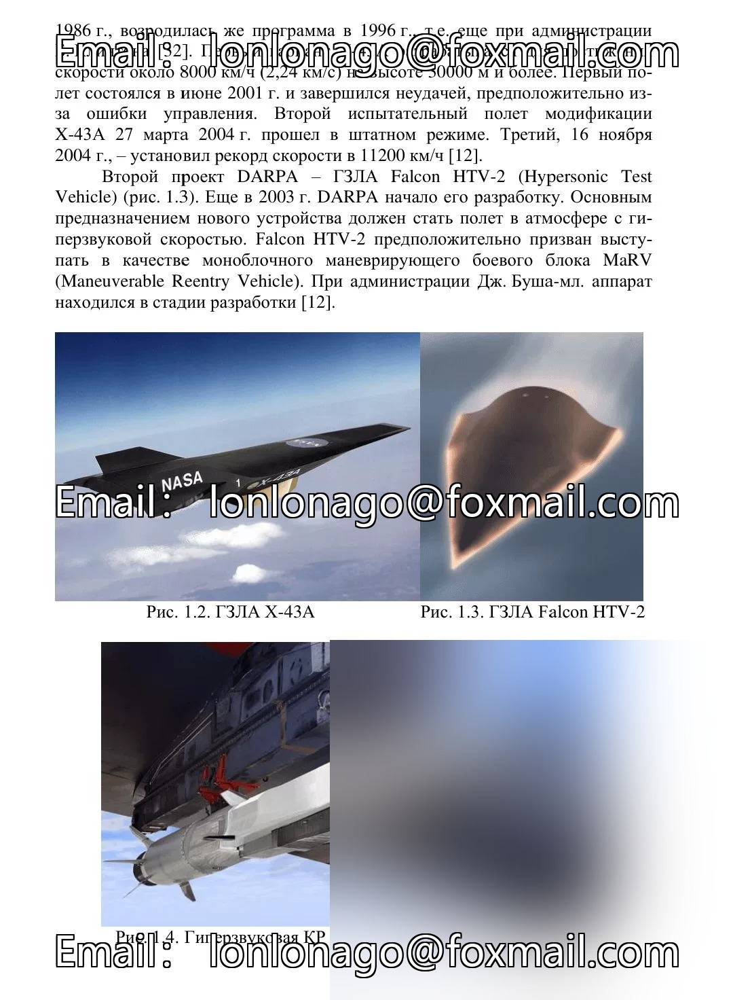
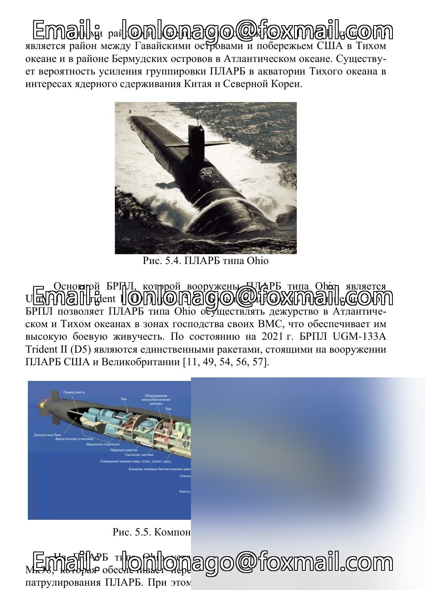
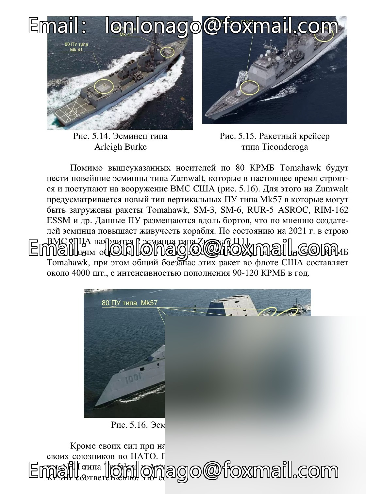
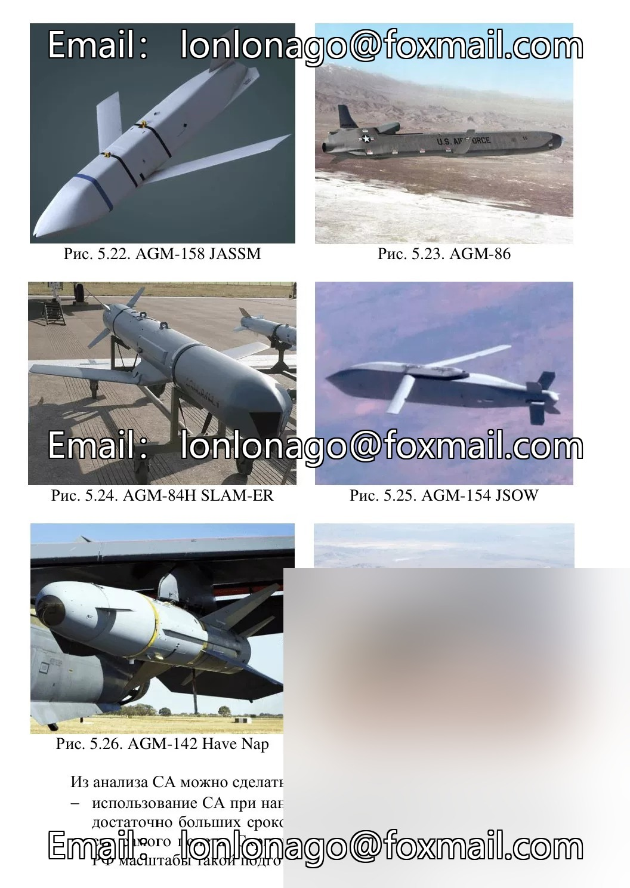

# 《Quick Global Assault: Review Analysis of Concepts, Possible Assault Scenarios, Power Composition, and Hand》

## Body

"Quick Global Assault: Review of Concepts, Possible Assault Scenarios, Force Composition, Means, Consequences, and Priority Measures for Response" - 176 pages.
Author: Afinin, I.E
The content covers global assault concepts, nuclear war theory, strategic nuclear force development, and nuclear deterrence strategies, suitable for military enthusiasts and reference research.
after sale.

The document covers retrospective analysis of global strikes, strike scenarios, force composition, means, consequences and response priorities; it spans 176 pages, authored by Афонin I.E, covering nuclear war theory, strategic nuclear force development and nuclear deterrence strategy, suitable for military enthusiasts and reference. It is for sale without refund.

<!-- AI_ENRICHED -->

## Images

## Payment

Here is a pay link on Stripe ( https://buy.stripe.com/3cs8yP7sY87d0vu9AB ). Please contact me lonlonago@foxmail.com after funding $89, and I will send you a complete data files , thank you!

